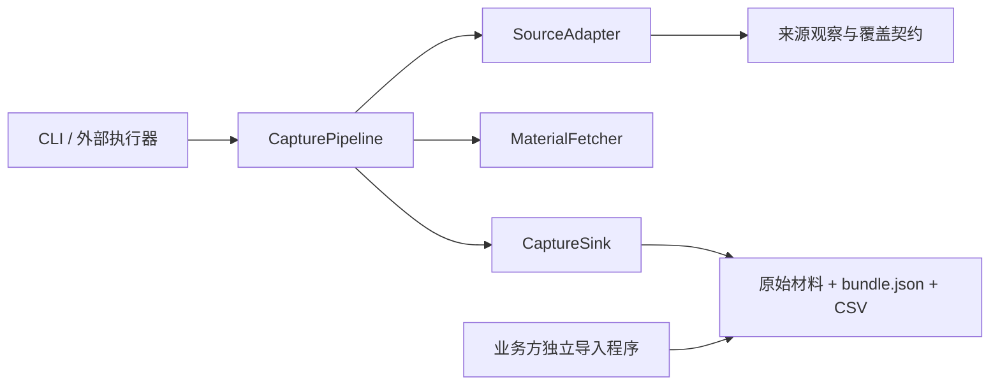

# 外部信息抓取模块抽象

本会话范围：外部信息抓取、来源核验、原始材料、解析、覆盖与文件交付。实现落在独立 `external-capture/`，不依赖其他业务代码。

## 现有系统审阅

项目主体为 Java 21 / Spring Boot / MySQL / Vue。采集入口在 `backend/.../api`，来源实现位于 `backend/.../collection`，业务查询、选用、规则和周报位于 `backend/.../service`。

| 现有实现 | 当前职责与耦合 |
| --- | --- |
| `AppleGamesService` | JSON 校验、材料存储、来源/榜单配置、产品/平台版本、快照、证据及媒体提取一起执行 |
| `AppBrainService` | 公开 HTML 解析与同类业务写入混合，保留来源缺口及估算指标 |
| `PublicMiniGameService` | 仅引力引擎渲染 HTML；保存到 `public_chart_observation`，查询还引用业务图标缓存；不是微信客户端采集器 |
| `AppleRssCollectionService` / `AppleRssPreviewService` | Apple Marketing Tools 全 App 免费榜，口径不同于游戏分类 6014 |
| `InsightCollectionService` | 网络请求、来源编排、JDBC 尝试记录、Spring 调度、市场分析查询、周报生成耦合 |
| `SnapshotMediaService` | 从既有快照与材料解析图标，依赖业务数据库 |
| `validation/`、`scripts/` | 含开发机取材、SSH 上传、服务端导入、部署验证；不能作为独立采集接口复用 |
| `data/captures/wechat-live-20261028-人气榜/` | 微信真实客户端既有独立证据；1–25 名的 PARTIAL 观察，不等于完整 Top100 |

## 依赖方向

采集模块不持有内部 productId、platformVersionId、chartId、snapshotId，不引用 Spring Controller、JdbcTemplate、产品查询、规则、选用、周报、前端或部署工具。调度由调用方触发；本模块没有启动即执行任务的副作用。

`SourceAdapter` 是来源语义边界，`MaterialFetcher` 是传输边界，`CaptureSink` 是输出边界。业务方后续消费契约时自行执行身份映射、业务去重、事务发布；这些决策不向采集模块回流。

## 本次实现

新增独立 Maven 构建与可执行 JAR，提供 Apple 游戏 RSS、AppBrain 公开榜单适配器，支持在线获取或本地材料提交。统一保存原始字节、SHA-256、来源 URL、原采集时间、解析器版本、条目证据定位、来源日期策略、覆盖和警告。

日期不允许重标：Apple 根据来源更新时间分别记录来源日与上海业务日；AppBrain 沿用来源显示日并声明时区未知。材料导入必须提供真实采集时间。排名缺口、重复 ID、来源范围变化和空材料经校验处理，错误材料不进入输出端口。

真实客户端观察与第三方网页观察分别保留来源身份。微信客户端已有独立导出工具继续使用；引力引擎、微信 UI 的标准适配器尚未迁入新增 Java 模块，不把第三方网页冒充官方榜单。

本次未改动现有后端、前端、数据库或定时任务，未部署、未采集新一轮在线榜单。已有服务仍有上述耦合，后续如迁移，应由业务层消费本模块契约逐源替换，不能声称现有系统已经全部解耦。

## 2026-10-28 验证记录

`mvn -f external-capture/pom.xml clean package` 构建通过，11 个测试全部通过；文件完成标记改为原子移动后再次构建与测试通过。可执行 JAR 帮助入口正常。

使用项目既有 2026-10-27 材料做离线端到端验证，未联网取新榜：

| 材料 | 结果 | 连续覆盖 | SHA-256 |
| --- | --- | --- | --- |
| `validation/apple-games-cn.json` | 100 条，REQUESTED_RANGE_COMPLETE | 1–100，无缺口 | `9f3921f508760aa11d8f65dd52648e2af1b207964cb1c81de0e5acaf8d3036ff` |
| `validation/source-research/appbrain-us.html` | 99 条，PARTIAL | 1–89，缺第90名，第91–100名保留 | `96efd1a6228fc6ca9a1ab95341018eeb2760a963606d7e5a43d20be61daf8f2c` |

输出位于 `data/captures/external-apple-test/` 和 `data/captures/external-appbrain-test/`，仅为既有材料的离线重解析，采集时间沿用原记录。自动审批策略阻止删除这些验证目录，故保留供核查。源码依赖检查未发现 `com.youkia.iaa`、Spring、JDBC 或周报/产品查询依赖。

## 本会话后续约束

新增来源优先补充来源身份、榜单口径、范围、原材料与解析样本，在本模块添加适配器并独立验证。不顺带改产品合并、IAA 判定、关注分、每周精选、业务数据库、界面或部署。来源受限、需要登录、材料不完整时交付明确缺口，禁止补造榜单、稳定 ID 或历史日期。
