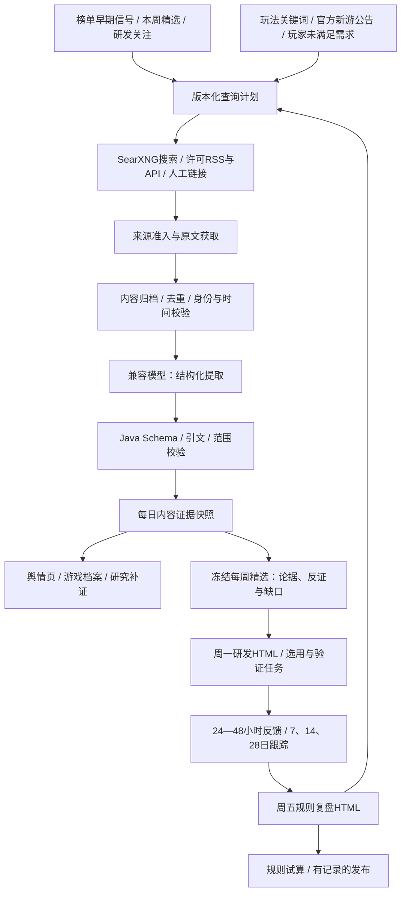

# 游戏内容与舆情采集：闭环开发计划

日期：2026-11-13。基线：代码 `9641a99`、Flyway V24、Java 21 / Spring Boot 3.5.6 / MySQL / Vue 3；每周最多5项，成熟基准20%、新入榜40%、单榜加速40%。

**文档状态：设计与开发计划，尚未实施。** 本轮核对了现有代码和官方文档，没有部署 SearXNG、启用新采集、调用模型分析游戏材料或改动推荐算法。下文新表、接口、参数、时间预算均为拟实施项，不能作为上线功能介绍。后续开发持续更新本文件的完成矩阵，并同步根目录 `ARCHITECTURE-DESIGN.md`。

## 1. 结论与技术选择

用户提出的“搜索采集 → 模型总结分类 → 数据库/知识库”方向可行，建议采用，但生产链路需补全为：

**榜单/玩法研究目标 → 搜索发现 → 来源准入与正文获取 → 身份关联、去重、时间核验 → AI提取及证据校验 → 日快照与研究补证 → 每周精选 → 研发验证 → 周五复盘 → 下轮查询和规则调整。**

|组件|采用方式|原因与边界|
|SearXNG|自建、私有服务，作为可替换的搜索发现适配器|聚合搜索引擎，返回链接/摘要；不是完整评论库，不保证中国内容覆盖，不代表有原站保存授权|
|正文与评论采集|复用现有 HTTP/网页规则工具，增加内容抽取适配层；RSS/许可API优先|摘要只能用作发现线索；正文、评论和新闻需要不同解析/抽样口径|
|AI模型|首先复用现有 `AiConfigService` 的 OpenAI 兼容供应商；以后可换独立服务器的 Ollama/vLLM|本地推理需要独立算力验收，不能默认在曾内存超限的业务主机安装大模型；不依赖个人电脑常开|
|Open WebUI|可选的人工研究、提示词试验界面；不置于必需的定时链路|它是应用界面/服务入口，不是模型本身。Java直接调用模型更容易记录幂等、成本、Schema和输入版本|
|自动研究Agent|后期可选，只能调用受控搜索/读取工具并提交草案|不得自行修改榜单、产品身份、IAA资格、发布规则或购买来源|
|存储查询|MySQL保存元数据、摘录、分析、关联和任务；权限允许的原始材料保存到现有材料目录|首期不新增向量数据库。后续语义检索是可重建索引，MySQL与证据文件仍是事实依据|

官方资料已于2026-11-13核实：SearXNG支持`/search`和JSON，但需显式启用`search.formats`中的`json`，未启用返回403；公开实例经常关闭该格式。`time_range`文档值为`day/month/year`，且只有部分引擎支持，不能假设存在精确“最近7天”过滤。Open WebUI可连本地或云端模型，其文档示例为`/api/chat/completions`；Ollama提供部分OpenAI兼容能力，不能把协议兼容视作所有模型都支持结构化输出。引用见第16节。

## 2. 已确认事项、建议默认与外部缺口

|类型|内容|处理方式|
|已确认|Linux后台常驻，Java+MySQL，模型已有配置页面，个人电脑不作为采集服务器|沿用工程和运维方式，Docker不是必需|
|已确认|统一产品、平台/地区/版本独立；跨榜不平均名次；缺失不能补成事实|舆情必须沿用相同身份与时间边界|
|已确认|最多5项，20/40/40目标；同周只保留一份报告，其他周可追溯|舆情不新增第6席，不暗改配额；审计材料不等于维护多份周报|
|已确认|周一交付研发、周五复盘，HTML离线导出|把舆情依据、反证、验证任务和实际反馈带进现有两份HTML|
|建议默认|先做中英文公开正文、官方公告、许可RSS；再接其他语言/评论源|英语不代表美国或英国玩家；来源国家/语言/发行市场分开记录|
|建议默认|首期只补研究依据，不自动改变推荐分数；成熟后试算同组优先级|先证明证据质量，再讨论排名收益；缺舆情不判负面、不影响原有榜单可用性|
|建议默认|采集预算80%补已知游戏、20%发现新玩法/新产品|这是搜索资源分配，**不是**每周精选20/40/40的席位比例|
|外部缺口|尚无已验证的专用SearXNG入口及服务器出口成功率|P0在候选Linux环境实测，不依赖免费公共实例生产稳定性；失败仍可走直接来源/RSS|
|外部缺口|微信、抖音、商店评论、论坛等具体接口、登录与允许保存范围未确定|逐来源登记能否搜索、取正文、取评论、留存、送模型；未满足的来源单独阻塞|
|外部缺口|如坚持本地模型，尚无GPU/显存/系统/模型许可与吞吐测试|不阻塞现有远程模型路线；不采购或预设GPU型号|
|外部缺口|当前模型额度/费用预算与舆情效果未测|现有配置可复用但不等于已验证；首轮小批测token/延迟，初始任务限额，超限暂停|

## 3. 当前工程复用与必须补齐的连接

|现有能力与位置|已存在什么|本计划补什么|
|`OnlineWebCaptureService`、`docs/18-ONLINE-WEB-CAPTURE.md`|HTTP/Firecrawl、草稿→试抓→发布、材料哈希、租约、失败记录|增加搜索与内容文档任务；通用网页结果仍不直接变成排名事实|
|`external-capture`、`WebTransport`|独立获取工具与解析约束|可复用传输抽象/校验器；不把业务产品库和推荐决策塞进独立采集模块|
|`SourceIdentityService`、V16|来源身份关联/撤销、时间范围、统一产品事件|内容关联支持未入库来源实体、已确认产品和独立平台发行范围|
|`GameProfileService`、V9/V11|`market_listing`、`profile_evidence`、提交复核、字段历史、补证任务|经核验的内容可转为档案材料，保存原证据引用与范围；AI内容不自动成为资格结论|
|`ProfileAiClient` / `ProfileAiService`|兼容模型调用、JSON Schema、原文quote验证、幂等输入哈希、待复核提交|抽出共享传输能力，新增舆情专用Schema/提示词；不复用档案字段Schema强塞新闻|
|`ResearchService.opinionSummary`、`ResearchWorkspace.vue`|已有“玩家评价与舆情”页；手工研究材料的内容簇、倾向和抽样范围|接入真实自动采集流；增加来源、时间、主题、相反证据、覆盖缺口与正文查看|
|`ResearchService.importPacket/enrich`|人工材料、资格门槛、可比评论输入、不可用状态|自动摘要走独立证据通道，不能创建一个“最新材料包”覆盖旧的人工身份/IAA/成本结论|
|`WeeklyReportService`、`CaptureResearchLeadService`|正式研究与来源研究两条路径、输入冻结、每周唯一、跨平台证据|两条路径都能附加`contentEvidence`；不能只补正式产品导致来源候选继续无内容|
|`research_outcome`及`/research/selections/{id}/outcomes`|已有验证反馈接口和简易录入页|建立报告条目→选用→验证任务→反馈的稳定关联、表单及周五读取|
|`WeeklyWorkflowService`、`weeklyHtml.ts`|已保存交付/复盘，HTML导出|增加论据/反证与研发假设；从对应报告快照取机制；复盘真正读取选用和反馈|

**代码核查发现，列入P0前置工作，当前未修复：**

1. `InsightCollectionService.weekly()`把`report.get("id")`强转为`Number`，而`WeeklyReportService.report()`返回字符串ID；存在周一生成报告成功、交付步骤失败的类型错误。统一ID转换并验证调度调用路径。
2. `WeeklyWorkflowService.reviewDocument()`当前未查询`research_outcome`；“基于已登记反馈”的旧文案超出实现。复盘须区分有反馈/无反馈/未到验证窗口。
3. 交付/复盘目前调用静态`mechanismSummary()`，应改从该报告`skill_snapshot`与`research_snapshot`取得冻结机制，旧报告不得套用新规则。
4. `ensureDelivery()`更新内容仍保留旧`ACKNOWLEDGED`；需把接收绑定到交付内容哈希/报告修订，变化后显示待重新确认，相同内容重复操作保持幂等。
5. 目前舆情列表读取人工`research_packet`；新的历史查询必须同时约束业务时间与系统实际获知时间，不能只按内容发布日期筛选。

## 4. 端到端架构与状态

搜索任务、网页抓取和AI分析分别有状态与重试，不能用一个成功标记掩盖某一环节失败：

- 任务：`PENDING/RUNNING/SUCCEEDED/PARTIAL/FAILED/INTERRUPTED/SKIPPED_BUDGET`，带租约、尝试次数与下次运行时间；进程恢复后重领过期任务。
- 来源结果：`FETCHED/SNIPPET_ONLY/LOGIN_REQUIRED/ACCESS_DENIED/RATE_LIMITED/TIMEOUT/PARSE_FAILED/RIGHTS_UNCONFIRMED`。
- 关联：`CONFIRMED/AMBIGUOUS/REJECTED/UNLINKED`；模型只提出候选，无法凭名称确认同一游戏。
- 分析：`VALIDATED/ABSTAINED/REJECTED/FAILED`；`VALIDATED`仅表示输出通过技术与引文校验，人工确认状态另存。
- 日快照：`COMPLETE_FOR_PLAN/PARTIAL/NOT_COLLECTED/NO_MATCH/ANALYSIS_PENDING`。完整仅指已配置范围执行完成，绝不意味着覆盖全网；成功搜索0结果是`NO_MATCH`，不是零讨论。

没有内容或模型故障时，正常输出既有榜单周报并写明缺口。禁止拿模型常识、昨日内容或搜索引擎估算结果总数补成当日真实数据。

## 5. 采集对象、来源与优先级

### 5.1 两条发现路径

**路径A：已有游戏补证。** 每日优先本期最多5项、研发在验5项、新入榜/单榜加速候选10项，去重后默认不超过20个目标。确认名称/别名、平台、发行商、稳定应用ID、语言与地区，组合3类查询：官方更新/玩法、玩家体验/广告负担、竞品/差异。通用名称如“Chess”必须加发行商或包名；不确定身份的内容留在待关联队列，不进入该游戏统计。

**路径B：榜前机会发现。** 用“已维护玩法词 + 新发布/测试/更新”和“玩家痛点/想要的改进”主题检索，订阅可用官方/行业来源。输出`新产品线索/玩法组合线索/未满足需求假设`，进入研究目标池，补身份、实机和榜单观察。没有榜单门槛的对象不直接占新入榜/加速席，也不把首次搜索到解释为首次上线。无证据的“蓝海”或“全新玩法”不得出现在精选结论。

查询模板、别名、排除词、来源清单、引擎、分页、语言和时间过滤都有版本。英文讨论不自动映射US/GB；地区未知的内容允许产品级定性参考，不能进入某国评价分母。首期中文/英文，DE/FR仍保留市场身份，德法原文适配列入扩展阶段。

### 5.2 来源矩阵（候选，不是接入承诺）

|顺序|来源候选|预期价值|获取方式与首期边界|
|1|游戏官网、开发者公告、更新日志|发布日期、玩法说明、版本事件|公开HTML或已存在的RSS；不预设每个站都有RSS；开发者宣传数字标为自述|
|1|GameLook、游戏葡萄、触乐、Game Developer等行业站点|新品、玩法趋势、竞品背景|搜索发现后按站点准入取正文/许可摘录；新闻不是玩家评价，转载只算同一内容簇|
|2|App Store/Google Play详情与公开可访问评论、TapTap等社区|玩法差异、广告/内购体验、痛点|具体接口与条款待验证；不得假定开发者评论API能读取任意竞品。无许可API则先做允许的定性样本或人工导入|
|2|B站公开文字介绍、Reddit/论坛讨论、公开公众号文章|实机线索、玩家需求、争议|逐站验证；登录/验证码/付费接口阻塞时不绕过。无文字证据不声称已理解视频玩法|
|3|微信/抖音内的完整评论流、评论历史、视频转写|更贴近小游戏玩家的反馈|需要来源许可/账号与可用导出；不承诺靠SearXNG覆盖应用内内容，OCR/转写另立采集项|

同一搜索请求命中多个引擎，不代表多个独立来源。每个来源记录`domain、owner/originFamily、contentType、允许抓取与保存范围、robots检查、速率、失败码、最后试采时间`。robots只是一项技术检查，不等于内容授权。未知保存范围时不默认保存全文或送模型，先保留允许的链接元数据及缺口；来源同意保存摘录后再处理。

### 5.3 初始预算（建议值，P0实测再锁定）

- 搜索：每天总上限75次请求，60次用于路径A（20目标×3模板），15次用于路径B。翻页和重试也占请求额度，不把每引擎扇出误算为免费无限次。
- 每查询最多10条发现结果，URL去重后每天最多抓150篇文档；同域默认并发1、请求间隔至少5秒，全局抓取并发2；源站更严格时服从源站限制。
- AI每天最多60个新材料分析任务、并发1；单文档送入摘录最多12,000字符，超长采用带原始偏移的分块，不能静默截断后声称完整分析。重试计入预算。
- 优先级：正在验证且有重大事件 → 本周精选缺口 → 新入榜/加速 → 日常主题发现。到限延后并显示`SKIPPED_BUDGET`，不无限扩大队列。
- 每个原始响应上限沿用/收紧现有4MB边界；模型输出上限与JSON校验必须明确。先用首批10份材料测token与费用，再配置日token/费用上限；费率未知时只显示实际token与未知费用，不假装成本为零。

## 6. 内容模型、身份、时间和去重

### 6.1 每条材料至少保留

`documentId、canonicalUrl、原始URL、来源/原始发布者、内容类型、语言、声明地区、标题、作者标识(仅必要的匿名化键)、publishedAt及可信度、observedAt、availableAt、excerpt/body及保存权限、rawSha256、normalizedSha256、rawLocator、解析版本、采样协议版本、来源抓取状态`。

内容类型至少区分官方公告、新闻、评测、玩家评论、论坛讨论、广告/推广、搜索摘要、未知。`发布者声称/玩家自述/实机核验/分析假设`分开存，不能把其中一种转换成另一种。评论作者跨站无法可靠去重时，不声称统计到了独立玩家人数。

### 6.2 身份作用范围

用一个研究目标键表达两种入口：`PRODUCT_LISTING`（已有product/listing）或`SOURCE_ENTITY`（现有`SourceEntity`身份键及外部观察引用）；不得为凑外键把来源候选自动建成正式产品。未入榜新线索使用独立`DISCOVERY_LEAD`目标。确认关联后增添事件，不抹掉原始目标。

内容可关联多个明确提及的游戏，关联需指定证据片段和`产品级/平台级/市场级/应用版本级`作用范围。平台未知只留产品级背景；某iOS版本的付费争议不得直接传播到微信版本。撤销关联需使后续聚合排除该关系，已导出历史文件不会被悄悄改写。

### 6.3 去重顺序

规范URL（只删除已知跟踪参数、不删除游戏ID） → 原文哈希 → 规范文本哈希 → 相似内容候选聚类 → 同源转载/原始发布者关系。保留所有发现和来源指向，但同一原文在多个引擎/多个转载站只算一个内容簇。摘要和全文优先归属同一文档；同URL正文发生变化新增内容版本，旧引用仍能回放。近似聚类保留算法版本及可撤销决定，不能仅凭主题相同把独立玩家反馈合并。

### 6.4 时间与回放

`publishedAt`为来源发布时间，缺失就为null；`observedAt`是取到材料的时间；`availableAt`是系统首次获知的服务器时间。AI与人工复核、关联事件也各有`availableAt`。历史视图只使用截止时已可用的材料、分析和关联，不能用后来提取的结论伪装为当时已知。

来源标11月1日、系统11月13日才首次取得的文章，不得自动进入11月1日历史周报。日期不明的内容可作为“首次观察线索”展示，不进入发布日期趋势。删除/失权后保留可允许的哈希与撤回说明，不保留不允许继续保存的正文；相关索引与缓存同步清理。

## 7. AI分析：交付内容和校验契约

新增专用契约`contracts/content-analysis.schema.json`和后台同源资源，计划`schemaVersion=content-analysis-1.0.0`、`promptVersion=content-extract-1.0.0`，以实际实现时发布为准。不是另建独立自动决策平台，也不把自由对话记录当结构化证据。

|输出|字段与要求|
|范围判断|`relevance=matched/ambiguous/unrelated`、候选目标ID、原文依据；不能直接确认跨平台身份|
|内容分类|内容类型、语言、主题数组；主题含玩法机制、爽点、广告负担、付费设计、难度/节奏、性能、社交、内容更新、竞品差异|
|观点与事实摘录|`claims[]:{kind, text, documentId, documentVersion, quote, startOffset, endOffset, scope, stance}`；kind为source_claim/player_opinion/hypothesis，均须引用|
|倾向|positive/negative/neutral/mixed/unknown；按主题与对象描述，不能把负面行业新闻等同玩家差评|
|机会假设|受众/需求/差异点/支持证据/相反证据/待验证问题；竞争空白必须有竞品核查才能确认|
|缺口|缺身份、缺正文、缺日期、矛盾、样本不足等；允许空结论和明确弃答|

Java负责：Schema严格枚举与长度上限、只引用输入中的documentId、quote与原始规范正文逐字匹配、偏移对应、证据已获准送该模型、目标范围、时间边界和来源状态。多语言摘要允许中文，但引用必须保持原文；翻译不能伪装成原始引文。只收到摘要则最多出发现摘要，不能输出正文级确认。

材料中的“忽略规则、访问这个网址、修改配置”等指令一律视为待分析文本。抓取内容不拼进system指令；模型无数据库写入、发布、任意联网或执行代码工具。结构化输出拒绝/截断/超时只记失败，不写成功结论，不补造引用。模型建议需要后续人工核验；置信度不是校准概率或成功率。

每次运行保存模型标识、配置修订（不含密钥）、温度、提示词/Schema/解析器哈希、输入文档版本与关联版本、token、耗时、失败码、实际获知时间。相同输入与配置的成功结果复用；失败允许有限重试；模型或关联版本改变产生新分析记录，不修改旧运行。

## 8. 如何用于“发现新机会”，而不是追逐讨论量

### 8.1 首期提供证据，不加一个舆情总分

每个候选新增一张内容证据卡：为何现在值得研究、玩法卖点原句、去重玩家痛点、竞争/成熟度反证、适用平台与日期、来源覆盖及下一步验证。每个结论都能跳到材料片段；没有证据的栏目显示缺口。

搜索结果条数、搜索名次、模型情绪分都不能用于增长判断。讨论量增加可能来自推广、争议或搜索配置变化，不等于用户增长。引擎/站点/抽样发生变化要断开趋势曲线。首期搜索型样本全部`comparable=false`，即使拿到100条也不能声称“全体玩家80%喜欢”。

### 8.2 三类机会的具体用途

|当前席位|舆情增加什么|不能替代什么|
|成熟基准1项|总结已验证卖点、同质化风险、平台适配边界|不能因很多媒体报道再增加成熟席|
|新入榜2项|新玩法/版本更新与名次变化的时间关系，玩家初始需求，竞品参照|完整榜单缺席基线、连续观察、实际名次上升|
|单榜加速2项|加速期间的更新/传播/争议，判断值得复核的可能原因|同榜加速分母、连续快照；相关性不能写成因果|
|研究补位/榜前线索|提炼可执行小实验，补玩法原文、稳定ID、版本证据|纯IAA门槛、实机确认、入榜资格；不额外扩大5项总数|

一个合格“机会假设”需要：①具体玩家需求或玩法差异；②至少能定位的原始论据；③反对证据/未证实部分；④现有竞品与替代方案；⑤24—48小时可执行的验证动作。建议优先审阅门槛为两个独立内容簇（明确转载不算第二个）；原文强度不足保持`HYPOTHESIS`。这不是自动入选阈值，也不能将两篇软文视为两位玩家的需求验证。

### 8.3 数量指标与后续试算

Java按单独来源族、内容类型、语言、市场、抽样协议、时间窗计算：去重内容簇数、可归属样本数、主题频次、未知/混合数、日期覆盖、失败来源、转载比例；玩家样本与新闻分开分母。只有受控且可比的评论采样协议通过验收，才可把样本倾向传给既有评价维度，仍注明样本偏差。

P3阶段才引入影子试算：同一候选集、相同席位与证据门槛，比较“现行规则”与“内容辅助同组优先级”的变化、提前发现时间、误关联率、误报及人工成本。保留不入选样本，避免只观察推荐成功案例。无反馈、未到随访期单列，不按失败或成功计。未完成时间切分回测与规则发布，不自动改现有推荐排序。

## 9. 每周精选、研发交付和规则复盘闭环

**周一交付：** 定时触发前取得已完成的内容快照，不等待整网搜索。在当前最多5项中，每项携带`为什么关注、原文论据、相反证据、未知项、验证假设、建议协议、负责人/期限、反馈入口`。HTML嵌入必要摘录与证据ID，外部链接标明联网查看；不嵌入未经许可的完整文章。首期由人填写负责人和实验预算，AI不假造。

**选用后：** 建立`reportId + recommendationRevision + itemKey → selectionId → validationTaskId → outcomeId`。来源候选没有正式product/listing时，沿用已支持的来源选用身份，保留来源键；后续身份关联不丢历史。状态为待分配/待核验/进行中/已反馈/延期/放弃；实验反馈继续使用已有`research_outcome`，新增关联字段而非另造结果系统。

**周五复盘：** 明确目标`recommendationWeek`，读取当周实际交付包/接收版本、截至复盘时可用反馈、后续榜单与内容证据。分栏展示“推荐当时已知”和“推荐后新获知”，不把事后新闻加入当初推荐理由。无反馈时说无反馈；发布成功、被选用、制作完成都不算商业验证成功。

**时间语义建议：** 周一交付使用刚结束的周一至周日观察窗口（截止周日），报告`weekStart`保持对应观察周；同时展示`deliveryWeekStart`。周五复盘上一个观察周的交付，而7/14/28日结局只展示已到期窗口。P0把此语义写入测试，以免把“本周交付”误作“本周刚采到的完整一周”。

**周五输出：** 本期机制版本与实际席位、研究/正式数、已分配/已反馈/未知数、证据补齐/撤销、误关联与转载问题、哪些假设支持/否定/尚未知、下一轮查询模板调整及规则试算建议。每条建议标记关联反馈/证据ID及预期改善，不由模型自动发布规则。

**每周唯一与追溯：** 继续保持`weekly_report.week_start`唯一，同周显式刷新覆盖内容并递增修订。增加不可变的交付接收事件和验证目标关联，只保存对应条目的必要快照/哈希以说明研发当时收到什么，不创建可切换的多份历史周报。当前交付包变化后旧接收事件留审计，当前状态须重新确认。页面和HTML展示`reportRevision、deliveryHash、reviewCutoff`。

## 10. 数据结构、API与页面改造清单

### 10.1 拟新增的数据职责

以下是逻辑表设计，最终DDL在实现阶段完成并同时更新`contracts/schema.sql`与Flyway；不覆盖V1—V24。迁移编号使用实施时下一个可用号，所有表/字段必须有中文COMMENT。

|拟新增/扩展对象|核心字段、唯一性和职责|
|`content_source_policy` / 不可变策略版本|sourceKey、domain、originFamily、获取/留存/模型传输权限、限速、有效期、revision；运行引用明确策略版本|
|`content_watch_target` / 查询计划版本|目标类型与键、别名/稳定ID、scope、queryPlan、priority、planHash、enabled；租户+目标键唯一，变更保留旧计划|
|`content_job`、`content_job_attempt`|阶段、目标、业务日、计划哈希、预算、lease、重试、状态；调度唯一键=租户+目标+日期+计划+阶段，尝试记录追加|
|`content_search_hit`|job/attempt、engine、query、position、URL、snippet、搜索返回状态；保留发现链路，不把position写成游戏排名|
|`content_document`、`content_document_version`|canonicalUrlHash与来源、正文版本哈希、时间、权限版本、rawLocator；文档唯一=租户+来源+规范URL哈希，内容版本独立去重|
|`content_document_link_event`|文档/片段→研究目标、scope、证据、关联/撤销、actor、effectiveAt/availableAt；追加事件与乐观锁|
|`content_cluster_event`|同原文/相似簇/原始发布者、算法与人工决定、撤销时间；记录聚类变化，历史聚合冻结引用|
|`content_analysis_run`|输入/输出哈希、文档版本、模型/配置/Schema/提示词版本、状态、claims JSON、token、耗时；同成功输入不重复调用|
|`content_signal_snapshot`|目标+业务日+可用截止+聚合版本+输入哈希、统计/缺口、证据和关联事件ID；重复输入复用，后续观察不倒灌旧日|
|`research_validation_task`与`research_outcome`扩展|条目稳定键、报告修订、交付哈希、选用ID、假设/协议、负责人、期限；已有反馈追加taskId，旧反馈兼容|
|`weekly_delivery_event`与工作流表扩展|内容变化、接收/撤销事件、报告修订、哈希；当前周报仍一份，当前交付/复盘仍各一个头记录|

索引先覆盖租户+目标+availableAt、来源+publishedAt、任务status+dueAt、引用ID与内容哈希；宽JSON/正文不放高频排序。中文全文查询先测试MySQL版本与ngram能力，小批可按标题/摘录及过滤查询；未验证前不宣称支持高质量语义检索。向量索引后置，必须沿用权限和时间过滤、可重建与删除传播。

文件沿用`CAPTURE_MATERIAL_DIR/content/{documentId}/{sha256}/...`，仅存允许材料；不可直接把材料目录映射公网。初始非冻结抓取材料保留30天、必要摘录和分析180天、周报/验证所引用的获准材料365天作为建议上限，最终以来源许可更短值为准；清理前检查引用，失权优先删正文并标失效，不为可追溯无限保留。数据库、材料与加密配置一起备份，恢复时校验哈希。

### 10.2 拟新增API（不是已可用接口）

|接口|行为|
|`GET/PUT /api/v1/admin/content/provider`|SearXNG入口/启停/timeout与revision，脱敏；模型仍复用现有AI配置|
|`GET/POST/PATCH /api/v1/admin/content/targets`及`/{id}`|研究目标与查询计划；服务端限定租户、目标范围和预算|
|`POST /api/v1/admin/content/targets/{id}/preview`、`/publish`、`/run`|先真实试采、核对权限和字段，再发布计划；人工执行有Idempotency-Key，返回202与jobId|
|`GET /api/v1/content/jobs`、`/jobs/{id}`|阶段、搜索命中、正文成功、分析成功、缺口、成本、可恢复失败|
|`GET /api/v1/content/documents`、`/documents/{id}`|按目标/主题/语言/来源/日期/availableCutoff检索与证据查看|
|`POST /api/v1/admin/content/documents/{id}/link-events`|确认/拒绝/撤销关联，Idempotency-Key+expectedRevision|
|`POST /api/v1/admin/content/documents/{id}/analyze`|输入已保存文档版本与模型配置修订；重用成功结果|
|`GET /api/v1/content/signals`|返回目标在指定日期的快照、覆盖、统计口径和引用，不补缺失|
|现有`/research/opinions`、档案API、周报API扩展|兼容增加contentEvidence，不把搜索新闻填进可比评论分母|
|拟新增`/api/v1/research/validation-tasks`及`/{id}`|验证表单和任务状态；结果继续通过现有outcomes写入并附taskId|

请求和响应写入`contracts`；BigInt ID对前端统一字符串，服务端统一解析；`asOf`（业务日期）与`availableCutoff`（UTC知识截止）分开。写请求返回幂等复用/冲突，接口状态不能仅靠HTTP 200判断业务成功。数据库事务不包围耗时网络/模型调用，阶段结果通过租约/compare-and-set落地。

### 10.3 页面复用

1. **信息抓取**：新增“搜索与内容”目标类型、查询预览、允许来源、预算、运行漏斗和错误定位；复用现有工作台，不另建一套后台。
2. **玩家评价与舆情**：列表先给产品/待关联对象、近期话题、机会假设、反证、资料日期、覆盖状态；详情默认折叠，展开查看原文、同源转载和分析版本。
3. **游戏档案 / 研究材料与补证**：提供“送审为档案材料”“创建核验任务”，人工确认范围后再写既有材料接口。
4. **每周精选**：卡片增加简短舆情证据摘要与缺口，保持推荐列表一眼可读；最多5项规则不变。
5. **研发交付 / 规则复盘**：接入任务与真实反馈；继续HTML下载，不要求研发阅读JSON；外部引用缺权时显示来源信息及不可回放原因。
6. **AI配置**：使用现有供应商；增加本任务协议自检、模型能力/Schema通过率、token统计，不把原始Key写进日志或浏览器。无登录用户体系也可保留已有工作区鉴权和可追溯操作人字段，不扩展多角色系统。

## 11. 调度、资源与故障恢复

- 独立Linux工作进程/服务，主机可同机小规模试跑，默认不安装本地LLM/Open WebUI；是否同机由P0实际内存余量与连续任务测试决定。SearXNG可采用官方非容器安装路径；锁定源代码commit及Python依赖，不跟随`latest`滚动升级。
- SearXNG仅绑定回环或受控私网，业务采集进程访问；搜索结果URL仍按公网目标校验。私有模型/SearXNG白名单只用于已配置供应商，不放宽任意网页URL到内网的权限。
- 拟配置：`CONTENT_ENABLED=false`、`CONTENT_SEARCH_BASE_URL`、`CONTENT_DAILY_CRON`、`CONTENT_SEARCH_REQUEST_LIMIT=75`、`CONTENT_FETCH_LIMIT=150`、`CONTENT_ANALYSIS_LIMIT=60`、`CONTENT_FETCH_CONCURRENCY=2`、`CONTENT_AI_CONCURRENCY=1`。启用时更新`.env.example`；本轮不添加未实现的配置到运行模板。
- 初始每天09:30与23:30分批更新（合计共享日预算），避开既有08:30/23:00榜单任务；周一09:00交付使用最近已完成且符合截止的内容，未完成显式降级。具体任务通过数据库租约防重复，无本地电脑任务。
- HTTP429/5xx最多3次总尝试，指数退避并遵守Retry-After；401/403/验证码进入需处理状态，禁止无限重试。失败保留最后成功材料但不得显示成今日新数据。
- 以进程MemoryHigh/MemoryMax、超时和队列长度限制保护业务。建议先给SearXNG及内容worker合计不超过约1.5GB的试跑预算并测压；这是预算假设，不是容量保证。资源不足时延后内容任务，优先保持榜单、数据库和Web服务。
- 观测：各引擎可用率、各源正文成功率、误关联、去重比例、可引用率、模型Schema/引文拒绝率、队列等待、内存峰值、token与实际费用；主界面显示最后成功时间和原因。
- 发布用功能开关逐来源灰度。回滚先关新调度和排序辅助，保留新增表与证据；旧周报/榜单不删。不可通过删数据来消除失败记录。

## 12. 阶段计划与完成定义

工期为单名熟悉工程开发者的工作量估算，不含外部账号审批、自然积累4周和不可控站点故障；每阶段先验收再扩量。

|阶段 / 预计|可执行任务与主要文件|交付与退出条件|依赖|
|P0 基线与试验，2—3工作日|修复第3节5项闭环问题的相关路径；核对周窗口；SearXNG非容器小实例/出口试验；选择国内外各1个允许正文来源；完成Schema、查询/权限协议、数据字典与版本锁文件|真实目标5个（国内3、海外2，数量是验收样本）跑搜索→正文；失败逐项记录；调度类型、冻结机制、反馈读取和接收版本有回归用例。若国外源不可达，不冒充双市场完成|可用Linux出口、现有AI配置；正文许可逐源确认|
|P1 最小内容链路，4—5工作日|实现内容表/迁移、SearxSearchAdapter、ContentFetchService、身份候选/去重、ContentAnalysisService与Schema；信息抓取运行详情|至少一个真实允许来源走完发现→材料→AI→Java校验→MySQL→证据查看；幂等、缺字段、注入、失败恢复通过；影子模式不改变推荐|P0确认的来源和协议|
|P2 产品研究与周报闭环，4—5工作日|扩ResearchWorkspace/GameProfile、正式与来源候选双通道接入、冻结contentEvidence、验证任务关联与表单、周一交付和周五反馈复盘、HTML模板|同一条真实线索能从周报点击回原文，登记核验反馈后在复盘显示；模拟反馈只进测试库。未实际研发时保留无反馈，不称已完成验证|P1与P0工作流修复|
|P3 榜前发现与受控评估，3—4工作日|玩法/需求主题目标、计划版本管理、发现池、同口径评论适配（有权限时）、时间切分影子试算、质量看板|与现行推荐做同输入对照；展示有效/未判/失败分母；累计4周真实反馈后给参数建议，不自动发布|足够历史和真实研发反馈；缺权限来源单独跳过|
|P4 扩源与检索，2—4工作日，可后置|德法文/许可评论扩展；按容量需要添加语义检索；可选Open WebUI/独立本地模型|来源逐一验收，检索返回可回放引用；没有资源/授权则保持明确未接入|新增来源权限/算力|

最小可用闭环目标为P0—P2，约10—13工作日；P3工程完成不等于4周效果已经验证。没有额外采购也能从已允许的公开正文和人工证据开始。完成每阶段需同步README、架构、接口/Schema、迁移/启动说明、环境模板与验收记录。

## 13. 验收清单（开发测试与真实验证分开）

|ID|业务场景|必须达到的结果|
|CI-01|同名不同游戏/名称改名/无稳定ID|候选关联待核，禁止自动串游戏；明确证据可确认并撤销|
|CI-02|同URL被3引擎发现、同文转载10次|保留发现记录，讨论/主题按同源内容簇只计1次|
|CI-03|两个独立玩家说相同痛点|不因主题相同误合并为转载；作者独立性无法证实则标未知|
|CI-04|搜索摘要存在、正文403/登录页/JS空壳|SNIPPET_ONLY或明确失败，不生成“已读正文”分析|
|CI-05|正文缺发布时间、发布时间早于首次采集|不补发布日期；历史知识截止不被后来材料污染|
|CI-06|中文/英文、新闻/评论、CN/US/未知地区混合|分组统计，不产生总体好评率；搜索采样comparable=false|
|CI-07|正文包含恶意指令/模型伪造quote或documentId|不执行、不访问附加网址；校验拒绝，不污染研究事实|
|CI-08|Schema失败、输出截断、模型超时/停用|分析失败/待处理，榜单与周报仍工作且显示缺口|
|CI-09|重跑、同时触发、worker宕机后恢复|租约互斥、幂等；不重复调用成功分析，不产生重复证据和周报|
|CI-10|只有新舆情、无新入榜基线/无IAA证据|只能补研究假设，不能升级新入榜/加速/纯IAA资格|
|CI-11|撤销产品关联、正文更新、模型/提示词变化|新增事件/运行；当前统计更新，旧冻结报告与引用保持原意|
|CI-12|新增内容与原人工核验结论共存|不因新研究包覆盖人工身份/IAA/成本；冲突可见并待复核|
|CI-13|报告修订后重新交付、旧接收确认|同哈希复用；内容变化当前接收失效、历史接收事件可查|
|CI-14|无研发反馈、有反馈、未到7日窗口|复盘分别显示未知/实际结果/未到期；选用和制作完成不冒充成功|
|CI-15|周一/周五时区边界、字符串报告ID|明确观察周/交付周，调度调用完整通过，不只测控制器手动入口|
|CI-16|相同周多次生成、其他周查询|仍一周一份；内容证据纳入输入哈希，历史周不自动改写|
|CI-17|抓取超限/内存紧张/引擎全失败|预算生效、独立失败、可恢复、榜单API可用，无OOM/假零舆情|
|CI-18|搜索命中内网/重定向内网/超大文档|目标和重定向/DNS逐次校验、阻止SSRF、限制大小和协议；不读取内部凭据|
|CI-19|正文留存权限撤回、超过保留期|撤回正文/派生索引，证据失效可见；不继续对外导出受限内容|
|CI-20|下载交付/复盘HTML并断网打开|可读、手机无溢出、证据ID/来源日期/修订保留，HTML文本转义有效|

真实验证单独记录：每个来源HTTP状态与是否登录、搜索请求/命中/取文/有效文档/去重/分析数、材料哈希、AI运行ID、快照ID、报告ID与修订、缺口和失败。不能用“官网文档可访问”替代“采集成功”。建议首轮人工标注不少于50篇（其中10篇双人复核）检验误关联、引用和分类；无双人资源时明确未完成，不杜撰一致率。

质量门槛建议：输出引用有效性100%（否则拒绝单条），误关联不得进入正式范围；候选关联准确率、主题/倾向人工一致率和来源覆盖先报告分子/分母，再确定扩量阈值。生产试跑至少连续7天无采集OOM、预算失控或核心榜单回归，周一/周五自然触发各一次或明确仍仅人工触发验证。

## 14. 发布与完成矩阵

|事项|本轮状态|下一步|
|三步方案可行性与官方资料核查|已完成|P0进行服务器真实搜索/正文试采|
|当前工程、接口、数据和周报连接点核查|已完成（静态代码核查）|按P0修复并新增针对性回归|
|采集/分析/存储/闭环开发方案|已形成本文|按P0→P1→P2实施，不另立一套产品|
|SearXNG部署和实际游戏内容采集|未开展|先锁版本、来源和预算|
|舆情Schema/迁移/API/页面代码|未实现|实施时同步contracts与中文DDL|
|AI真实分析与质量评估|未开展|使用已配置模型小批验证，保留实际token与拒绝记录|
|周报内容证据、验证任务、反馈复盘贯通|待实施|完成双通道冻结与反馈关联，真实反馈缺失不得宣称闭环效果|
|本地模型/Open WebUI/向量检索|可选后置|数据量/私有化需求/算力证据足够时再启用|

本轮为文档与设计交付，不执行生产迁移/重启/调度启用。当前无需用户再次填写MySQL或模型密钥。首次上线须真实确认SearXNG的服务器访问、至少一个允许正文来源及模型传输范围；某付费平台阻塞不影响其他允许来源。只有新增采购/业务范围变化才需要单独业务决定。

## 15. 建议的首个开发迭代

先完成P0及P1中的一个最小纵向链路：从当前真实精选选1个身份清晰的游戏 → 3类查询 → 获取允许的正文 → 保存哈希/日期/来源 → AI只读提取 → Java校验 → 舆情页显示原文及缺口。再接入该条目的周报HTML与一条研发验证任务，保证最早交付的是可追溯闭环，而不是一个只有搜索框的独立知识库。

P0顺带修复现有工作流的类型/冻结机制/反馈读取/接收版本问题；未来每个阶段更新本文中的实际结果、实际运行版本和未验证来源。

## 16. 官方参考与核查记录

以下页面于2026-11-13实际读取（HTTP 200），用于确认技术能力；不是游戏数据源试采结果。读取内容本地留存在忽略目录`data/research/content-plan-20261113/`。

1. [SearXNG Search API](https://docs.searxng.org/dev/search_api.html)：JSON格式开关、403、搜索参数及有限的时间过滤。
2. [SearXNG search设置](https://docs.searxng.org/admin/settings/settings_search.html)：formats与引擎错误暂停设置。
3. [SearXNG非容器逐步安装](https://docs.searxng.org/admin/installation-searxng.html)：Python虚拟环境/系统依赖；不要求Docker。
4. [Open WebUI连接模型供应商](https://docs.openwebui.com/getting-started/quick-start/connect-a-provider)：本地/远程模型配置，Open WebUI与模型服务的职责。
5. [Open WebUI API Endpoints](https://docs.openwebui.com/reference/api-endpoints/)：鉴权和`/api/chat/completions`示例。旧`getting-started/api-endpoints`路径返回404，已使用现行路径核实。
6. [Ollama OpenAI compatibility](https://docs.ollama.com/api/openai-compatibility)：兼容接口是子集；实际模型能力仍需通过本项目Schema和业务测试。

SearXNG在线文档当日显示构建标识`2026.11.12+de722ab1b`，该标识不是本项目安装版本。P0必须在部署清单记录实际commit、依赖锁、Python版本、启用引擎及验证日期；不得用本文链接的“最新版本”代替版本锁定。
